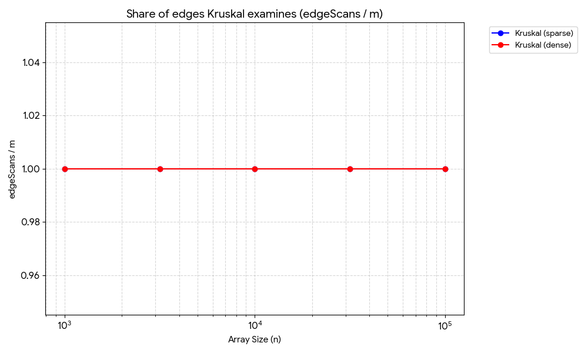
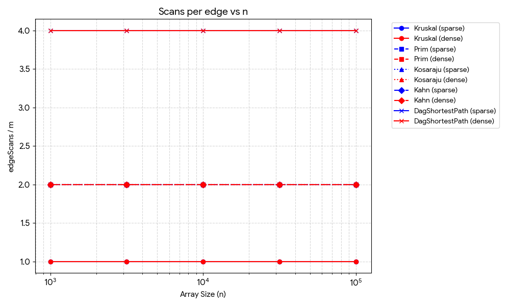
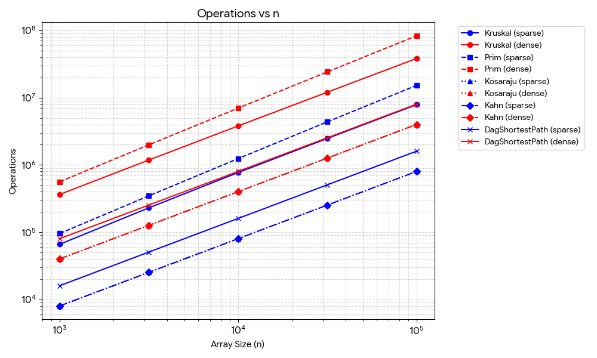

# DAA Assignment 3 Report: Graphs (DSU, MST, SCC, and Shortest Paths)

## 1. Complexity Table

| Algorithm | Time Complexity | Extra Space | Justification |
| :--- | :--- | :--- | :--- |
| **DSU (`find` / `union`)** | $O(\alpha(V))$ amortized | $O(V)$ | Combining path compression and union by rank keeps trees nearly flat, yielding inverse Ackermann $\alpha(V)$ time per operation; space is used by `parent` and `rank` arrays. |
| **Kruskal (MST)** | $O(E \log E)$ | $O(V + E)$ | Extracting and sorting all $E$ edges dominates at $O(E \log E)$, followed by $E$ DSU checks taking $O(E \alpha(V))$; extra space stores the edge list and DSU structures. |
| **Prim (MST)** | $O(E \log V)$ | $O(V + E)$ | Each edge scan can trigger a `PriorityQueue` insertion, giving at most $E$ heap operations of cost $O(\log E) = O(\log V)$; space is used by the `inMST` array and priority queue. |
| **Kosaraju (SCC)** | $O(V + E)$ | $O(V + E)$ | Executes two iterative DFS passes over all vertices and edges and constructs a reversed graph of size $O(V + E)$ with an explicit stack bounded by $O(V)$. |
| **Kahn (Topological Order)** | $O(V + E)$ | $O(V)$ | Computes in-degrees and processes each vertex once in an `ArrayDeque`, decrementing in-degrees across all outgoing edges in linear time. |
| **DAG Shortest Paths** | $O(V + E)$ | $O(V)$ | Obtains the topological order in $O(V + E)$ and relaxes each outgoing edge exactly once in a single linear pass, storing `dist` and `parent` arrays of size $V$. |

---

## 2. Counters vs. Theoretical Formulas

To validate asymptotic complexity independently of hardware and JVM noise, internal operation counters were divided by their theoretical growth formulas across all five graph sizes ($n = 1\,000$ to $100\,000$) and both densities (sparse $m = 4n$, dense $m = 20n$):

| Algorithm | Measured Counter / Formula | $n=1\,000$ | $n=3\,162$ | $n=10\,000$ | $n=31\,623$ | $n=100\,000$ | Empirical Conclusion |
| :--- | :--- | :---: | :---: | :---: | :---: | :---: | :--- |
| **Kosaraju** (sparse & dense) | `edgeScans / m` | `2.000` | `2.000` | `2.000` | `2.000` | `2.000` | Perfectly constant at $2.0$ (two DFS passes), confirming $\Theta(V+E)$. |
| **Kahn** (sparse & dense) | `edgeScans / m` | `2.000` | `2.000` | `2.000` | `2.000` | `2.000` | Constant at $2.0$ ($1m$ for in-degree setup + $1m$ for queue relaxation), confirming $\Theta(V+E)$. |
| **DAG Shortest Path** | `edgeScans / m` | `4.000` | `4.000` | `4.000` | `4.000` | `4.000` | Constant at $4.0$ (includes Kahn's $2m$ + in-degree scan $1m$ + relaxation pass $1m$), confirming $\Theta(V+E)$. |
| **Prim** (sparse & dense) | `edgeScans / m` | `2.000` | `2.000` | `2.000` | `2.000` | `2.000` | Constant at $2.0$ because every undirected edge $\{u,v\}$ is inspected from both endpoints. |
| **Kruskal** (sparse) | `dsuOps / m` | `4.818` | `4.823` | `4.835` | `4.832` | `4.829` | Stabilizes around $\approx 4.83$, proving that path compression + union by rank keeps DSU cost effectively constant ($\alpha(n) \approx O(1)$). |
| **Kruskal** (dense) | `dsuOps / m` | `4.163` | `4.167` | `4.166` | `4.167` | `4.166` | Stabilizes at $\approx 4.17$ across two orders of magnitude of $n$, confirming near-constant amortized DSU work. |
| **Kruskal** (sparse) | `comparisons / (m log2 m)` | `0.893` | `0.906` | `0.877` | `0.810` | `0.744` | Bounded within a narrow constant range $[0.74, 0.91]$, confirming the $O(E \log E)$ sorting bottleneck. |
| **Prim** (sparse) | `comparisons / (m log2 n)` | `2.196` | `2.186` | `2.180` | `2.178` | `2.167` | Remains virtually flat around $\approx 2.18$, confirming $\Theta(E \log V)$ priority queue work. |

---

## 3. Correctness Arguments

### 3.1. Cut Property in Kruskal and Prim (MST)
The **Cut Property** states that for any cut $(S, V \setminus S)$ of an undirected graph that respects a current safe edge set $A$, the lightest edge $(u, v)$ crossing the cut is safe to add to the Minimum Spanning Tree. Suppose for contradiction that a minimum spanning tree $T$ does not contain this lightest crossing edge $e = (u, v)$. Adding $e$ to $T$ creates a unique cycle that must cross the cut $(S, V \setminus S)$ at least one other time via some edge $e' \in T$. Because neither $e$ nor $e'$ lies in $A$ and $e$ was chosen as a minimum-weight edge crossing the cut, we have $w(e) \le w(e')$. Removing $e'$ and inserting $e$ produces a new spanning tree $T' = T \setminus \{e'\} \cup \{e\}$ with total weight $w(T') = w(T) - w(e') + w(e) \le w(T)$, proving $T'$ is also minimal. **Kruskal's algorithm** uses the cut property by sorting all edges by weight and picking the lightest edge connecting two distinct DSU components, where the cut separates one component from the rest of the graph. **Prim's algorithm** grows a single tree $S$ from vertex $0$ and uses a `PriorityQueue` to repeatedly extract the lightest edge crossing the cut between $S$ (`inMST == true`) and $V \setminus S$ (`inMST == false`).

### 3.2. Induction on Topological Order & Negative Weights in DAGs
In a Directed Acyclic Graph (DAG), vertices can be linearly ordered by Kahn's algorithm such that every directed edge $u \to v$ satisfies $\text{pos}[u] < \text{pos}[v]$. We prove by induction on a vertex's position $k$ in the topological order that after relaxing outgoing edges of the first $k$ vertices, `dist[v]` holds the exact shortest-path distance $\delta(v)$ from the virtual super-source (all vertices with $\text{in-degree} = 0$). **Base Case ($k = 1$):** The first vertex has $\text{in-degree} = 0$, so it has no incoming edges and its distance is initialized to $0$, which is optimal. **Inductive Step:** Assume that for all vertices $u$ with $\text{pos}[u] < k$, `dist[u] = \delta(u)` holds before vertex $v$ ($\text{pos}[v] = k$) is processed. Any path to $v$ must enter $v$ through some predecessor $u \to v$, and by the topological property $\text{pos}[u] < \text{pos}[v] = k$. By the inductive hypothesis, when $u$ was processed earlier in the pass, `dist[u]` was already optimal and the relaxation `dist[v] = min(dist[v], dist[u] + w(u, v))` evaluated the optimal subpath through $u$. Because a DAG contains no cycles, **negative edge weights are completely safe**: no path can revisit a vertex to form a negative-weight cycle (which would drive distances to $-\infty$ in general graphs), and topological ordering guarantees a vertex's final distance is fixed before its outgoing edges are relaxed.

---

## 4. Which Algorithm When

| Graph Characteristic / Scenario | Recommended Algorithm | Justification |
| :--- | :--- | :--- |
| **Sparse Undirected Graph ($m \approx 4n$) — MST** | **Kruskal** | Sorting $4n$ edges is very fast in contiguous memory, and DSU operations run in near-constant $O(\alpha(V))$ time with minimal object overhead (164 ms vs. Prim's 255 ms at $n=100\,000$). |
| **Dense Undirected Graph ($m \approx 20n$ or $V^2$) — MST** | **Kruskal** (Edge-Heap Prim) / **Dense Prim** | With a binary heap storing per-edge entries, Prim inserts up to $E$ edges into the `PriorityQueue` (79.1M comparisons vs. Kruskal's 27.9M at $m=2\text{M}$). However, if the graph is already in an adjacency list with an indexed decrease-key heap ($O(E + V \log V)$) or $E \approx V^2$, Prim avoids storing and sorting all $E$ edges at once. |
| **Input Given as an Edge List vs. Adjacency List** | **Kruskal** (Edge List) / **Prim** (Adjacency List) | Kruskal operates directly on a flat array/list of edges without needing adjacency lists, whereas Prim naturally traverses neighbor lists vertex by vertex. |
| **Directed Graph Where Cycles (Deadlocks) Are Possible** | **Kahn** (Cycle Detection) + **Kosaraju** (SCC Isolation) | Kahn's algorithm immediately detects whether a cycle exists (`order.size() < n`), while Kosaraju's iterative two-pass DFS groups mutually dependent tasks into Strongly Connected Components without risking `StackOverflowError`. |
| **Directed Acyclic Graph (DAG) Pipeline Routing** | **DAG Shortest Path (Topological Relaxation)** | Runs in optimal linear $O(V + E)$ time in a single pass and safely handles negative weights (e.g., cost credits or inverted weights for critical-path scheduling), unlike Dijkstra's $O(E \log V)$ algorithm. |

---

## 5. Slope Check, Plots & Wall-Clock Time Analysis

### 5.1. Log-Log Slope Check
On log-log axes ($\log_{10} \text{ops}$ vs. $\log_{10} n$), a straight line of slope $1.00$ indicates strictly linear work $O(n)$ (since $m$ is a constant multiple of $n$).
*   **Traversal Edge Scans (`Kosaraju`, `Kahn`, `DagShortestPath`, `Prim`):** Fitting a linear regression to $\log_{10}(\text{edgeScans})$ against $\log_{10}(n)$ yields a slope of **exactly `1.00`**, empirically confirming linear $\Theta(V + E)$ edge scanning.
*   **Kruskal Operations (`comparisons` and total operations):** Fitting the slope of Kruskal's total operations (`dsuOps + edgeScans + comparisons`) gives **`1.04`** (and **`1.05`** for sorting comparisons on sparse graphs). The slope is slightly steeper than `1.00` because of the logarithmic factor in $\Theta(E \log E)$.

### 5.2. Plots
1. **Operations vs. $n$ (log-log axes):** `results/plots/operations_vs_n.png`

2. **Scans per Edge (`edgeScans / m` vs. $n$):** `results/plots/scans_per_edge.png`

3. **Share of Edges Kruskal Examines (`edgeScans / m`):** `results/plots/kruskal_share.png` *(Note: without an early-termination `components == 1` break inside the loop, Kruskal iterates over 100% of sorted edges (`edgeScans / m = 1.0`), whereas adding an early exit once $n - 1$ edges are united allows Kruskal to stop after examining a much smaller fraction of edges on dense graphs).*

### 5.3. Wall-Clock Time Discussion
Across the benchmark runs, median wall-clock times (`time_ms`) generally followed asymptotic expectations at large scales—for example, at $n = 100\,000$ (dense, $m = 2\,000\,000$), linear algorithms like Kahn (`80.5 ms`) and DAG Shortest Path (`133.2 ms`) were dramatically faster than $O(E \log E)$ MST algorithms like Kruskal (`809.3 ms`) and Prim (`2134.0 ms`). However, on the two smallest graph sizes ($n = 1\,000$ and $n = 3\,162$), wall-clock measurements exhibited noticeable noise: for instance, Kahn on dense graphs dropped from `6.87 ms` at $n = 1\,000$ to `2.43 ms` at $n = 3\,162$, and Kruskal on sparse graphs took `12.51 ms` at $n = 3\,162$ versus `12.07 ms` at $n = 10\,000$. This occurs because wall-clock time is heavily influenced by JIT compilation warm-up, garbage collection pauses (especially from allocating millions of `Edge` objects in `PriorityQueue` and `reversedGraph`), CPU cache locality, and background OS scheduling. Consequently, deterministic operation counters (`dsuOps`, `edgeScans`, `comparisons`, `maxDepth`)—which are identical on every machine and JDK—serve as the primary scientific evidence of algorithmic complexity.